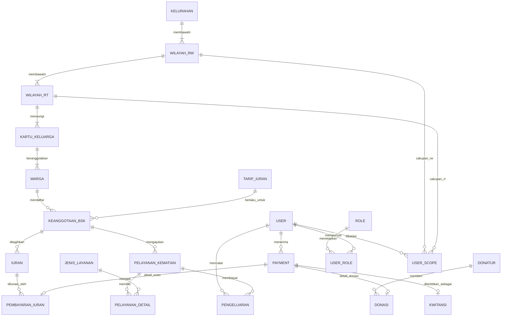

# ERD dan LRS Prototipe Administrasi BSK

Dokumen ini adalah rancangan akademik untuk prototipe panel admin. Rancangan ini **belum** mengubah skema SQLite aplikasi Kifayah produksi.

## Aturan bisnis utama

1. Satu kelurahan membawahi banyak RW; satu RW membawahi banyak RT.
2. Satu KK memiliki banyak warga; setiap warga hanya memiliki satu RT aktif pada satu waktu.
3. Warga dapat memiliki paling banyak satu keanggotaan BSK aktif. Statusnya: `pending`, `aktif`, `suspend`, atau `meninggal`.
4. Tarif berlaku berdasarkan kategori domisili dan satuan (`per_kk` atau `per_jiwa`).
5. Iuran dan donasi adalah penerimaan yang berbeda, tetapi keduanya diturunkan dari satu entitas induk `PAYMENT`. Ini membuat nominal, tanggal terima, dan penerima tidak diduplikasi.
6. Satu `PAYMENT` dapat diterbitkan satu kwitansi. Kwitansi tidak boleh memiliki dua sumber pembayaran sekaligus.
7. Pengeluaran boleh terhubung ke layanan kematian, tetapi hubungan itu opsional karena ada pengeluaran operasional umum.
8. Klaim kematian hanya dapat dibuat bagi anggota dengan status aktif; rincian layanan menggunakan tabel detail agar tidak berupa daftar teks berulang.
9. Hak akses ditentukan oleh peran dan cakupan wilayah pengguna; peran LMK bersifat baca-saja.

## ERD (konseptual)

## LRS (Logical Record Structure)

Tanda `PK` adalah primary key, `FK` adalah foreign key, dan `UQ` adalah kandidat key unik.

| Relasi | Atribut inti |
|---|---|
| `KELURAHAN` | `id_kelurahan (PK)`, `nama (UQ)`, `kecamatan`, `kota_administrasi` |
| `WILAYAH_RW` | `id_rw (PK)`, `id_kelurahan (FK)`, `no_rw`, `nama_ketua`, `no_hp`; `UQ(id_kelurahan,no_rw)` |
| `WILAYAH_RT` | `id_rt (PK)`, `id_rw (FK)`, `no_rt`, `nama_ketua`, `no_hp`; `UQ(id_rw,no_rt)` |
| `KARTU_KELUARGA` | `id_kk (PK)`, `nomor_kk (UQ)`, `id_rt (FK)`, `alamat`, `status_domisisli` |
| `WARGA` | `id_warga (PK)`, `id_kk (FK)`, `nik (UQ)`, `nama`, `jenis_kelamin`, `tgl_lahir`, `status_warga` |
| `TARIF_IURAN` | `id_tarif (PK)`, `kategori_domisili`, `satuan`, `nominal`, `berlaku_mulai`, `berlaku_sampai` |
| `KEANGGOTAAN_BSK` | `id_anggota (PK)`, `id_warga (FK)`, `id_tarif (FK)`, `tgl_daftar`, `status`, `aktif_sampai` |
| `IURAN` | `id_iuran (PK)`, `id_anggota (FK)`, `periode`, `nominal_tagihan`, `status`; `UQ(id_anggota,periode)` |
| `PAYMENT` | `id_payment (PK)`, `jenis`, `tgl_bayar`, `nominal`, `id_penerima (FK→USER)`, `catatan` |
| `PEMBAYARAN_IURAN` | `id_payment (PK, FK→PAYMENT)`, `id_iuran (FK)`; `UQ(id_iuran)` |
| `DONATUR` | `id_donatur (PK)`, `nama`, `telepon`, `alamat`, `tipe` |
| `DONASI` | `id_payment (PK, FK→PAYMENT)`, `id_donatur (FK)`, `tujuan_donasi` |
| `KWITANSI` | `id_kwitansi (PK)`, `no_kwitansi (UQ)`, `id_payment (FK,UQ)`, `id_penerbit (FK→USER)`, `tgl_terbit`, `checksum_pdf` |
| `PELAYANAN_KEMATIAN` | `id_pelayanan (PK)`, `id_anggota (FK)`, `tgl_lapor`, `tgl_meninggal`, `status`, `id_petugas (FK→USER)` |
| `JENIS_LAYANAN` | `id_jenis_layanan (PK)`, `nama (UQ)` |
| `PELAYANAN_DETAIL` | `id_pelayanan (PK,FK)`, `id_jenis_layanan (PK,FK)`, `status`, `catatan` |
| `PENGELUARAN` | `id_pengeluaran (PK)`, `id_pelayanan (FK,nullable)`, `id_pencatat (FK→USER)`, `tgl_pengeluaran`, `kategori`, `nominal`, `catatan` |
| `ROLE` | `id_role (PK)`, `nama (UQ)` |
| `USER` | `id_user (PK)`, `username (UQ)`, `password_hash`, `nama`, `aktif` |
| `USER_ROLE` | `id_user (PK,FK)`, `id_role (PK,FK)` |
| `USER_SCOPE` | `id_scope (PK)`, `id_user (FK)`, `id_rw (FK,nullable)`, `id_rt (FK,nullable)` |

## Normalisasi sampai 3NF

- **1NF:** nilai layanan tidak disimpan sebagai teks multivalue; pasangan layanan disimpan dalam `PELAYANAN_DETAIL`.
- **2NF:** detail layanan menggunakan kunci gabungan dan atributnya bergantung pada keseluruhan pasangan `id_pelayanan + id_jenis_layanan`.
- **3NF:** informasi donor, tarif, petugas, wilayah, dan penerbit dipisahkan dari transaksi agar tidak terjadi ketergantungan transitif atau anomali pembaruan.
- **Subtipe pembayaran:** `PAYMENT` sebagai supertype memisahkan penerimaan umum dari detail iuran/donasi. Hal ini lebih aman dibanding dua FK sumber nullable di tabel kwitansi, karena setiap kwitansi selalu merujuk tepat ke satu `PAYMENT`.

## Relasi/kardinalitas penting

`KELURAHAN 1:M RW`, `RW 1:M RT`, `RT 1:M KK`, `KK 1:M WARGA`, `WARGA 1:M KEANGGOTAAN_BSK (riwayat)`, `KEANGGOTAAN 1:M IURAN`, `PAYMENT 1:0..1 PEMBAYARAN_IURAN`, `PAYMENT 1:0..1 DONASI`, `PAYMENT 1:0..1 KWITANSI`, dan `PELAYANAN_KEMATIAN M:N JENIS_LAYANAN` melalui `PELAYANAN_DETAIL`.

## Integritas dan keamanan yang harus diterapkan saat integrasi

- NIK, nomor KK, nomor telepon, dan alamat tidak masuk ke daftar publik atau ekspor umum.
- Simpan kata sandi hanya sebagai `password_hash` dengan Argon2id/bcrypt; jangan pernah pada kolom `password` biasa.
- Tambahkan `CHECK` untuk status dan nominal positif, `UNIQUE(id_anggota,periode)` untuk menahan iuran ganda, serta transaksi database saat menyimpan pembayaran dan kwitansi.
- Terapkan RBAC serta scope RW/RT di sisi server, bukan hanya dengan menyembunyikan tombol di frontend.
- Catat audit `siapa-kapan-apa` untuk perubahan keanggotaan, pembayaran, pengeluaran, dan penerbitan kwitansi.
